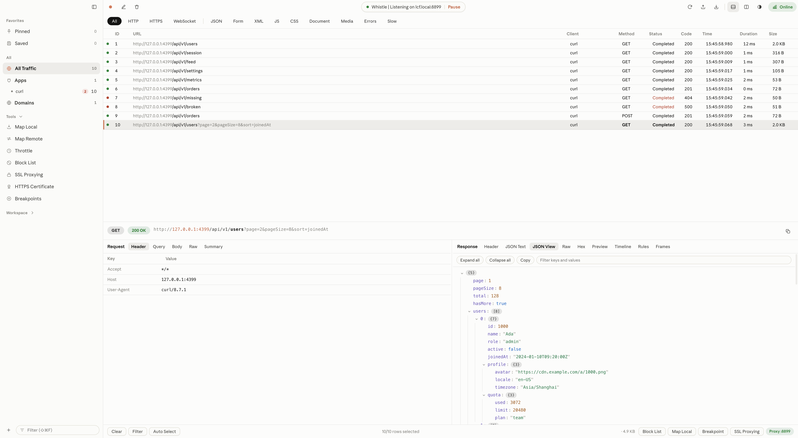
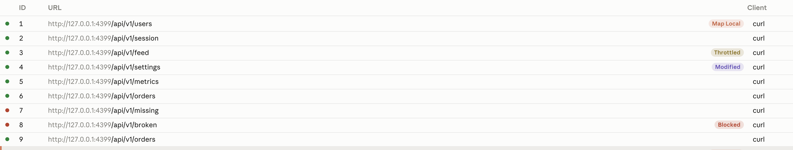
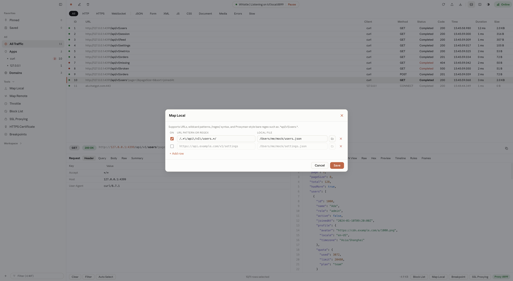
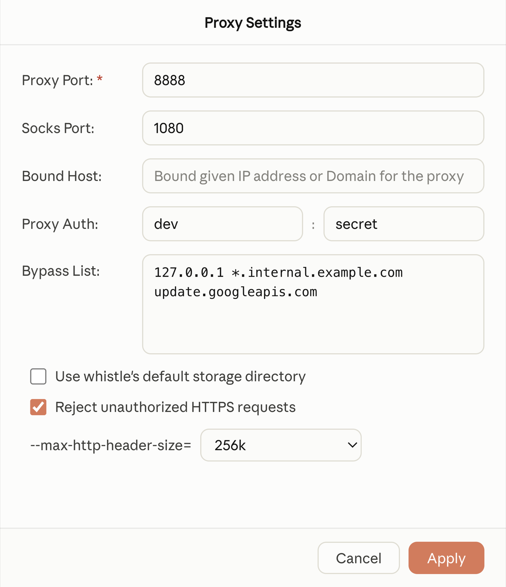

# Whistle Client

[中文](./README.md) · English

> **This repository is a fork of [avwo/whistle-client](https://github.com/avwo/whistle-client).**
> Everything upstream does still works; this fork rebuilds the interface on top of it. File upstream bugs upstream, UI bugs here.

[Whistle](https://github.com/avwo/whistle) is a cross-platform web debugging proxy. This repository is its desktop client, for:

- macOS (Apple Silicon / Intel)
- Windows
- Linux (Fedora / Ubuntu)

whistle's own rule syntax, plugin system and so on are documented at https://wproxy.org/docs/getting-started.html

> On a headless server or a device without a desktop, use the command-line whistle instead: https://github.com/avwo/whistle

## Installation

<details>
  <summary>macOS</summary>

**1. Pick the right package**

- Apple Silicon (M series) → [Whistle-vx.y.z-mac-arm64.dmg](https://github.com/cf-L/whistle-client/releases)
- Intel → [Whistle-vx.y.z-mac-x64.dmg](https://github.com/cf-L/whistle-client/releases)

**2. Install**

Open the `.dmg` and drag Whistle into Applications.


If it says the app already exists, choose replace; if it cannot replace, quit the running client first.

**3. First launch**

This fork's packages are **not signed or notarised**, so macOS refuses to verify the developer. Either:

- right-click Whistle in Finder → Open → Open, or
- run:

  ```bash
  xattr -dr com.apple.quarantine /Applications/Whistle.app
  ```

Some corporate security tools flag it. Allow it on first run, and ask IT to whitelist Whistle if it keeps being blocked.

</details>

<details>
  <summary>Windows</summary>

**1. Pick the right package**

- (Recommended) Standard, needs administrator rights: [Whistle-vx.y.z-win-x64.exe](https://github.com/cf-L/whistle-client/releases) — full features, including the `whistle://client` protocol
- Per-user, no administrator rights: [Whistle-user-installer-vx.y.z-win-x64.exe](https://github.com/cf-L/whistle-client/releases) — no protocol handler

**2. Install**

Run the installer, accept the User Account Control prompt, then follow the wizard.


</details>

<details>
  <summary>Linux (Fedora / Ubuntu)</summary>

- Intel/AMD 64-bit: [Whistle-vx.y.z-linux-x86_64.AppImage](https://github.com/cf-L/whistle-client/releases)
- ARM 64-bit: [Whistle-vx.y.z-linux-arm64.AppImage](https://github.com/cf-L/whistle-client/releases)

For how to run an AppImage, see https://docs.appimage.org/introduction/quickstart.html

</details>

### First run

Two things get you capturing:

1. `Whistle` menu → `Install Root CA`: installs and trusts the root certificate, so HTTPS from this machine can be decrypted
2. `Whistle` menu → tick `Set As System Proxy`: points the system proxy at the client, so this machine's requests come through

Phones and tablets need a different flow — see [Capturing HTTPS from a phone](#capturing-https-from-a-phone).

## The interface

The client ships with this fork's own modern UI: it is mounted on whistle's own web server through the `uiMiddleware` hook (at `/pm`), same origin as `/cgi-bin`, and plugins are still mounted the way whistle mounts them.

The upstream classic UI is kept in full. Two ways to reach it:

- `Whistle` menu → untick `Modern UI`, and the whole window goes back to the classic interface
- or stay in the modern UI and open `Workspace → Classic UI` in the sidebar, which embeds it in the current window

The look follows Claude Desktop: a flat sidebar, hairline dividers, the same palette. If Claude Desktop is installed the Anthropic Sans font is read from it; otherwise the stack falls back to the system face (no font file is copied into this repository).

### Request list and inspector

The request list is a Proxyman-style table (ID / URL / Client / Method / Status / Code / Time / Duration / Size). Click a header to sort; the context menu copies the URL, copies as cURL, replays the request; rows can be pinned and saved. URLs are split into host / path / query, with the path standing out.

The inspector below is split in two: Request on the left, Response on the right. Response bodies can be read as JSON Text (highlighted source with line numbers), JSON View (collapsible tree with a key/value filter and a copy button), Raw, Hex or Preview.



### Rule badges

When an enabled rule acts on a request, a badge appears at the end of the URL column; hovering it shows the rule line that matched:

| Badge | Rule operators |
| --- | --- |
| Map Local | `file://` `xfile://` `tpl://` |
| Blocked | `statusCode://` |
| Throttled | `resSpeed://` `reqDelay://` and friends |
| Proxy | `proxy://` `socks://` |
| Host | `host://` |
| Modified | `replace://` `resBody://` `resHeaders://` and friends |
| Disabled | `disable://` |



> Badges are worked out in the client by matching each URL against the enabled rule text, so they cover hand-written rules too, but they are an approximation of whistle's own matching. Complex rules (several operators, includes/excludes conditions) may be judged wrongly; the response itself is the source of truth.

### Stacked filters

`⌘F` opens the filter panel. Stack as many conditions as you like, each with a field (URL / Host / Path / Method / Status / Headers / Body / Type) and an operator (Contains / Not contains / Equals / Matches regex), combined with AND or OR. The checkbox on each row parks a condition without deleting it, and `Save` keeps the set for the next launch.


### Keyboard shortcuts

Shortcuts belong to **the region being worked in**, not to the window. A dialog owns the keyboard while it is open; below that, it depends on whether the last click was in the request list or in the inspector.

| Shortcut | Request list | Inspector | While a dialog is open |
| --- | --- | --- | --- |
| `⌘F` | opens the URL filter | searches the current pane | ignored |
| `⌘A` | — | selects that pane only | stays inside the dialog |
| `Esc` | closes the filter | closes the find bar | closes the dialog |
| `↑` `↓` | moves the selected request | — | ignored |
| `⇧⌘F` | sidebar search | sidebar search | — |
| `⌘K` | clears the capture list | | |
| `⌘R` | starts / pauses capturing | | |
| `⌘\` | collapses / shows the sidebar | | |
| `⌘,` | opens Proxy Settings | | |

The inspector's own context menu (Copy, Select All, Copy this pane) is scoped to the pane under the cursor as well.

### Dark mode and inspector docking

The buttons at the top right dock the inspector at the bottom or on the right; clicking the active one collapses it. Both the docking side and the theme are remembered. The theme follows the system and can also be switched by hand.


### Tools

`Tools` in the sidebar holds the rewriting tools. Everything they generate goes into a single whistle rule file called `Modern UI Tools`, one delimited block per tool, so hand-written rules outside those blocks are left alone.


Every table starts with an `On` checkbox. Unticking a row does not delete it: the rule is commented out but kept in the file, so it is still there next time and can be switched back on.

#### Map Local

Serves a local file instead of the matched request. Takes full URLs, wildcards, `/regex/`, and Proxyman-style bare regex (`.*api/v1/users.*` is wrapped in slashes for you). The local file can be picked with the native file dialog.



#### Map Remote

Forwards the matched request to another address — typically a production host pointed at a local server.

#### Throttle

Speed and delay. The presets follow Apple's Network Link Conditioner profiles (Wi-Fi / LTE / 3G / DSL / Edge / High Latency DNS / Very Bad Network / 100% Loss); choosing one fills the table below, which you can then edit. Apple states Kbps and whistle wants KB/s; the conversion is done for you.


> whistle has no packet-loss primitive, so a profile's loss rate is surfaced as a note, and `100% Loss` is approximated with a 502 response.

#### Block List

Returns a status code (403 by default) for matched requests.

#### SSL Proxying

Domains listed here are **not** decrypted; they stay as `CONNECT` tunnels. Useful for apps that pin certificates, or just to cut noise.

#### Breakpoints

Holds a request for a given number of milliseconds, built on whistle's `reqDelay://`.

### Capturing HTTPS from a phone

Capturing HTTPS from a phone or tablet needs three things: the device pointed at this machine as its proxy, whistle's root certificate installed **and trusted** on the device, and HTTPS decryption switched on in the client. All three live in one dialog.

**Where**: `Tools → HTTPS Certificate` in the sidebar. The `Online` popover at the top right also links to it ("Set up HTTPS on another device →").


**Steps**

1. **Turn on decryption**: tick `Decrypt HTTPS traffic` at the top of the dialog (whistle's `Capture HTTPS CONNECTs`). Without it, HTTPS only ever shows up as `CONNECT` tunnels with nothing inside.

2. **Put the phone on the same Wi-Fi**, then point its proxy at the address in step 1 of the dialog (something like `192.168.1.23:8899`). With several network interfaces, use the dropdown to pick the one the phone can reach.
   - iOS: `Settings → Wi-Fi → ⓘ next to the current network → Configure Proxy → Manual`, then copy the server and port from the dialog
   - Android: long-press the current network → `Modify network → Advanced → Proxy → Manual`, same IP and port

3. **Install the certificate**: scan the QR code on the right with the phone's camera, or open the URL from step 2 by hand.
   - iOS: Safari says a profile was downloaded; install it under `Settings → General → VPN & Device Management`
   - Android: after downloading, go to `Settings → Security → Encryption & credentials → Install a certificate → CA certificate` and pick the file

4. **iOS needs one more step**: `Settings → General → About → Certificate Trust Settings`, and turn the switch on for whistle. Installed but not trusted means HTTPS still fails — this is the step people miss.

5. **Check it**: open any https site on the phone. The client should list requests for that domain with `Code` 200 rather than `CONNECT`, and the decrypted body should be readable in Response.

This machine's own certificate does not need any of that: use `Download root certificate` in the dialog, or `Whistle` menu → `Install Root CA` to install and trust it in one step.

> The link in the QR code carries this session's access token (without it the phone is refused by the auth check), so only hand it to your own devices. The QR code is generated locally — see [`public/pm/js/qrcode.js`](./public/pm/js/qrcode.js) — with no third-party dependency.

**If nothing shows up**

- **Only `CONNECT` / tunnels, no individual requests**: `Decrypt HTTPS traffic` is off, or the domain is in the `SSL Proxying` exclusion list
- **The phone says the certificate is not trusted**: on iOS, step 4 was skipped. On Android 9 and later, apps do not trust user-installed CAs unless they ship a `networkSecurityConfig` or you use a debug build; the system browser is unaffected
- **The phone cannot reach the proxy**: use the LAN IP rather than a hostname (phones usually cannot resolve it), and check both devices are on the same subnet with the port open in the firewall
- **Some apps show no traffic at all**: they almost certainly pin certificates. Use a test build, or let them through in `SSL Proxying`

### Workspace

`Workspace` at the bottom of the sidebar opens whistle's own areas:

- **Rules**: add, edit and enable rule files. The editor is a plain text box with no syntax highlighting; complex rules are easier to edit in the Classic UI
- **Values**: whistle's Values storage
- **Plugins**: installed plugins, which can be enabled, disabled and opened
- **Classic UI**: the upstream interface, embedded in the current window

**Installing plugins** is done in the classic UI for now (`Workspace → Classic UI`, or untick `Modern UI` in the `Whistle` menu):

1. Open the Plugins tab in the left-hand navigation
2. Click Install at the top
3. Type the plugin names, separated by spaces or newlines; `--registry=` picks an npm mirror


For example, installing two plugins from a mirror:

```txt
w2 install --registry=https://registry.npmmirror.com whistle.script whistle.inspect
```

### Proxy Settings

`Whistle` menu → `Proxy Settings`, or `⌘,`. The settings themselves are exactly upstream's; only the look was brought in line with the rest of the app.



1. `Proxy Port`: required, the proxy port, `8888` by default
2. `Socks Port`: a Socks v5 port
3. `Bound Host`: which interface to listen on
4. `Proxy Auth`: a username and password for requests through the proxy
5. `Bypass List`: what not to proxy, in three forms
   - IP: `127.0.0.1`
   - hostname: `www.test.com`
   - wildcard: `*.test.com` (covers every subdomain of `test.com`)
6. `Use whistle's default storage directory`: store data where the command-line whistle stores it, reusing that configuration. Stop the command-line whistle first, or the two will overwrite each other

### Known limitations

- Breakpoints are a "hold" built on `reqDelay://`, not a real interactive breakpoint you can edit a request in
- The rule editor is a plain text box with no whistle syntax highlighting
- Plugins are installed from the classic UI
- Rule badges are the client's local approximation, not whistle's own matching result

> Apart from the installation images, every screenshot above was taken against a local demo server (`127.0.0.1:4399`) and contains no real traffic.

## The Whistle menu

| Item | What it does |
| --- | --- |
| `Proxy Settings` | opens the settings window (`⌘,`) |
| `Install Root CA` | installs and trusts the root certificate on this machine |
| `Check Update` | checks for a new version |
| `Set As System Proxy` | points the system proxy at the client (`⌘R`) |
| `Start At Login` | launches the client at login |
| `Modern UI` | switches between the modern and the classic interface |
| `Hide To Tray` | closing the window hides it in the tray instead of quitting |
| `Hide In Dock` | macOS: no Dock icon |
| `Restart` / `Quit` | restarts / quits the client |

## FAQ

**1. After setting the system proxy, some applications (Outlook, Word, …) lose connectivity**

Those domains show up as `captureError` requests in the capture list. Add them to `Bypass List` in `Proxy Settings`.

**2. How do I update the client?**

- `Whistle` menu → `Check Update`, and follow the prompts
- or download the latest build from [Releases](https://github.com/cf-L/whistle-client/releases) and install over the old one

**3. How do I capture HTTPS from a phone or tablet?**

See [Capturing HTTPS from a phone](#capturing-https-from-a-phone).

**4. How do I keep the data from the command-line whistle?**

The client uses its own storage directory by default. Tick `Use whistle's default storage directory` in `Proxy Settings` to point it back at the command-line default.

> Make sure only one whistle instance uses that directory at a time; running two will overwrite each other's configuration.

## Building and releasing

Installers are built by GitHub Actions on their native runners (`.github/workflows/release.yml`): macOS produces arm64 and x64 dmgs, Windows an x64 nsis installer, Linux x64 and arm64 AppImages (which cover both Fedora and Ubuntu).

To cut a release:

1. Bump `version` in `package.json` and add a section to `CHANGELOG.md`
2. Commit, then tag and push:

   ```bash
   git tag v1.8.0 && git push origin v1.8.0
   ```

3. The workflow uploads all three platforms into the same **draft** release, with the body taken from that version's `CHANGELOG.md` section (`scripts/release-notes.js`). Publish it by hand once the artifacts look right

The client's `Check Update` reads the `version` in `package.json` on this repository's `main` branch, and Download goes to `releases/download/v<version>/<installer for this platform>` — so the file names in a release have to stay in the `Whistle-v<version>-<platform>-<arch>.<ext>` shape (electron-builder's `artifactName` is already set up for it).

Building locally (only for the current platform):

```bash
npm run build:mac
```

## License

[MIT (see the LICENSE file)](./LICENSE)
