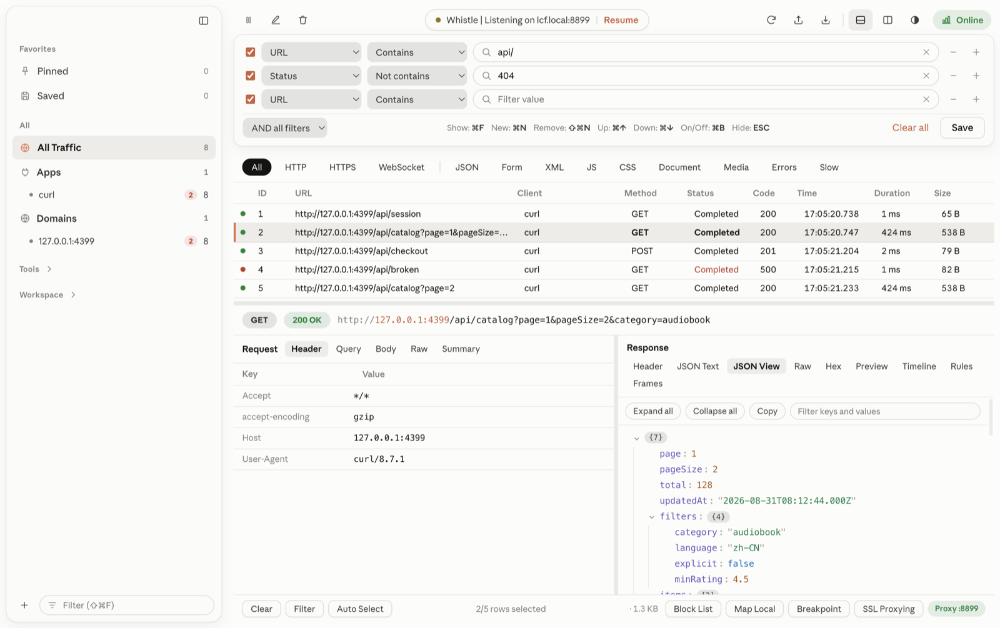
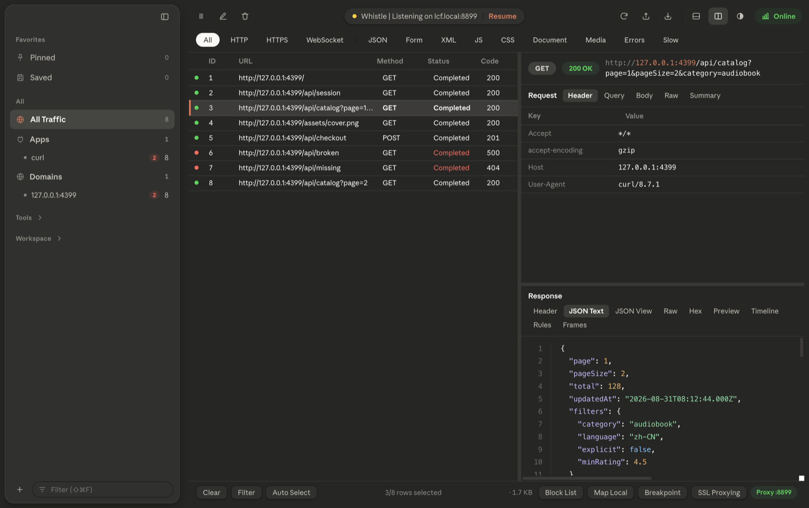
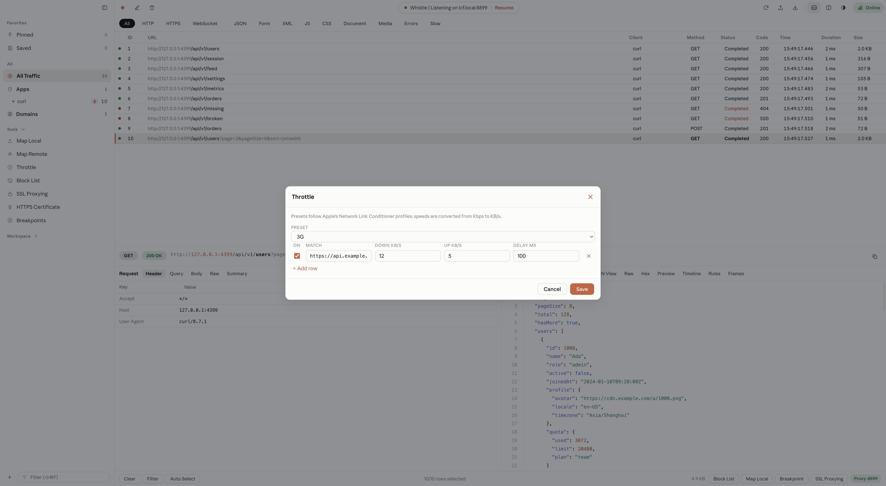
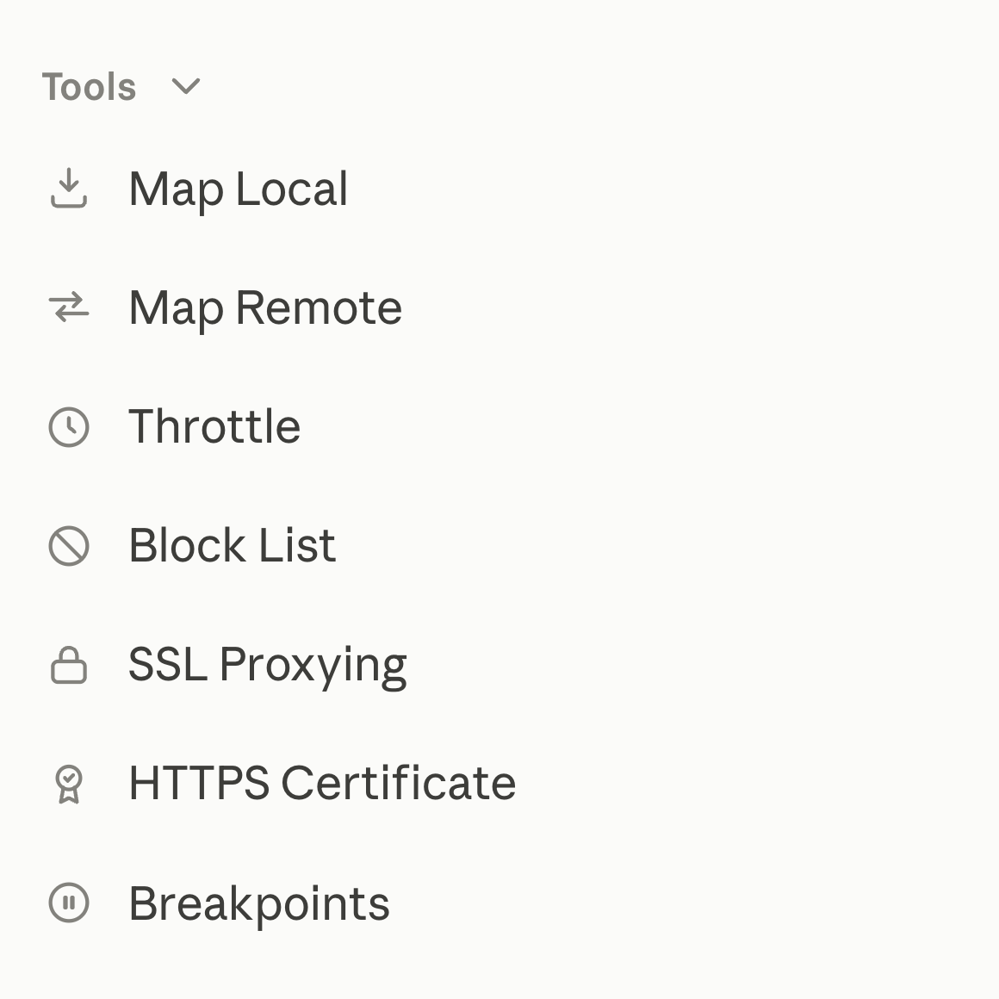
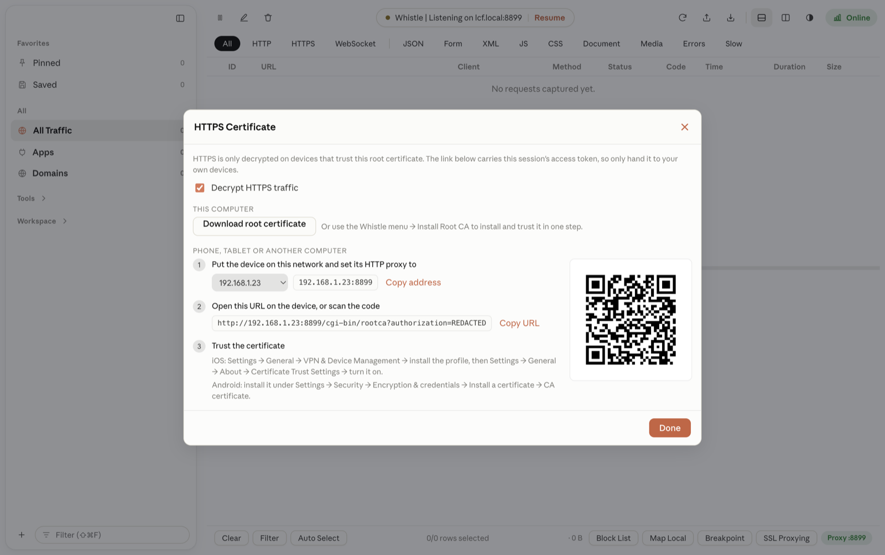

# Whistle Client

[中文](./README.md) · English

> **This repository is a fork of [avwo/whistle-client](https://github.com/avwo/whistle-client).**
> Everything upstream still works the same; this fork adds a Proxyman-style modern UI on top of it (see [Modern UI](#modern-ui-added-by-this-fork) below). Report upstream bugs upstream, UI bugs here.


[Whistle](https://github.com/avwo/whistle) is a powerful cross-platform network packet capture and debugging tool. This repository is a fork of its official desktop client and supports the following operating systems:
- macOS（Apple Silicon / Intel）
- Windows
- Linux（Fedora / Ubuntu）

> If the system you are using does not support the Whistle Client (such as a server without a graphical interface or a special device), you can use the Whistle: https://github.com/avwo/whistle

# Modern UI (added by this fork)

A self-contained capture UI mounted on whistle's own web server through its `uiMiddleware` hook (at `/pm`), so it shares an origin with `/cgi-bin` and keeps the plugin iframe contract intact. The upstream classic UI is still there and one menu item away.

- Enabled by default; uncheck `Whistle` menu → `Modern UI` to go back to the classic one
- Visually aligned with Claude Desktop: floating sidebar, rounded corners, matching palette. When Claude Desktop is installed the UI uses its Anthropic Sans; otherwise it falls back to the system face (no font file is copied into this repo)

### Request list and inspector

A Proxyman-style column table (ID / URL / Client / Method / Status / Code / Time / Duration / Size) with sorting, a context menu, and Pinned / Saved marks. The inspector splits request on the left and response on the right.


### Stacked filters (⌘F)

`⌘F` opens the filter panel. Stack as many conditions as you like — each picks a field (URL / Host / Path / Method / Status / Headers / Body / Type) and a match (contains / not contains / equals / regex) — combined with AND or OR, and saveable. `ESC` leaves filter mode.



### Dark mode and inspector docking

The two buttons at the top right dock the inspector at the bottom or on the right; clicking the active one hides it. Both the dock position and the theme are remembered. Response bodies render as JSON Text (highlighted source with line numbers), JSON View (collapsible tree with key/value filtering and one-click copy), Raw, Hex, or Preview.



### Map Local

Accepts URLs, wildcards, `/regex/`, and Proxyman-style bare regex; the local file is picked through the native file dialog.


### Throttle

Presets are Apple's Network Link Conditioner profiles (Wi-Fi / LTE / 3G / DSL / Edge / High Latency DNS / Very Bad Network / 100% Loss), plus custom rates and delay.



### HTTPS certificate and mobile devices

Capturing HTTPS from a phone or tablet needs three things: the device's proxy pointed at this machine, whistle's root certificate installed **and trusted** on the device, and HTTPS decryption switched on here. One dialog covers all three.

**Where**: `Tools → HTTPS Certificate` in the sidebar. The `Online` dialog also links to it with "Set up HTTPS on another device →".





#### Steps

1. **Turn on decryption**: tick `Decrypt HTTPS traffic` at the top of the dialog (whistle's `Capture HTTPS CONNECTs`). Without it HTTPS only shows up as `CONNECT` tunnels with no visible content.

2. **Put the device on the same Wi-Fi**, then point its proxy at the address from step 1 of the dialog (something like `192.168.1.23:8899`). With several interfaces, use the dropdown to pick the one the device can reach.
   - iOS: `Settings → Wi-Fi → ⓘ next to the network → Configure Proxy → Manual`, server and port copied from the address in the dialog
   - Android: long-press the network → `Modify network → Advanced → Proxy → Manual`, the same IP and port from the dialog

3. **Install the certificate**: scan the QR code with the device camera, or open the URL from step 2 by hand.
   - iOS: Safari says the profile was downloaded — install it under `Settings → General → VPN & Device Management`
   - Android: after downloading, go to `Settings → Security → Encryption & credentials → Install a certificate → CA certificate` and pick the file

4. **iOS needs one more trust step**: `Settings → General → About → Certificate Trust Settings`, then enable the whistle entry. Installing without trusting leaves HTTPS broken — this is the step people miss.

5. **Verify**: open any https site on the device. Its requests should appear in the list with a `200` code rather than `CONNECT`, and the decrypted body should be readable in the Response pane.

This computer does not need that flow: click `Download root certificate` in the dialog, or use `Whistle` menu → `Install Root CA` to install and trust it in one step.

> The link inside the QR code carries this session's access token (without it the device is stopped by whistle's auth), so only hand it to your own devices. The code is generated locally — see [`public/pm/js/qrcode.js`](./public/pm/js/qrcode.js), no third-party dependency.

#### If nothing shows up

- **Only `CONNECT` tunnels, no individual requests**: `Decrypt HTTPS traffic` is off, or the host sits in the `SSL Proxying` exclusion list
- **The device says the certificate is not trusted**: on iOS, step 4 was skipped; on Android 9+, apps do not trust user-installed CAs unless they ship a `networkSecurityConfig` or you use a debug build — the system browser is unaffected
- **The device cannot reach the proxy**: use the LAN IP rather than the hostname (devices usually cannot resolve it), and check both are on the same subnet and that the firewall allows that port
- **A specific app shows no traffic**: it most likely pins its certificate; use a test build or let it through in `SSL Proxying`

### Proxy Settings

Same options as upstream, restyled to match the rest of the app.


> Every request in these screenshots comes from a local demo server (`127.0.0.1:4399`); no real traffic is shown.

### Known limitations

- Breakpoints are a `reqDelay://`-based hold rather than a true interactive intercept-and-edit
- The rules editor is a plain textarea with no whistle rule syntax highlighting; switch to the classic UI to edit rules there

# Installation
Please select the corresponding installation steps according to your operating system.

<details>
  <summary>macOS</summary>

##### 1. Select the correct installation package

Select the corresponding version according to your Mac processor type:
- Apple Silicon chip (M1/M2/M3 series) → Download ARM 64-bit version: [Whistle-vx.y.z-mac-arm64.dmg](https://github.com/cf-L/whistle-client/releases)
- Intel/AMD chip → Download x86_64 version: [Whistle-vx.y.z-mac-x64.dmg](https://github.com/cf-L/whistle-client/releases)

##### 2. Installation steps

1. After downloading, double-click the downloaded `.dmg` file

2. Drag the Whistle icon to the Applications folder

    
3. If the following situations occur:

   - "Application already exists" → Select "Overwrite"

   - Unable to overwrite → Please exit the running Whistle client first

##### 3. Security Tips

This fork's installers are **not code-signed or notarized**, so macOS refuses them on first launch. Either:
- right-click Whistle in Finder → Open → Open again, or
- run `xattr -dr com.apple.quarantine /Applications/Whistle.app`

Some enterprise security software may give false positives. Suggestions:

- Select "Allow" when running for the first time

- If there is continuous interception, please contact the IT department to add Whistle to the whitelist

</details>

<details>
  <summary>Windows</summary>

##### 1. Download the installation package

Choose the appropriate version according to your permission requirements:

- [Recommended] Standard Edition (Administrator permissions required): [Whistle-vx.y.z-win-x64.exe](https://github.com/cf-L/whistle-client/releases)
    > Supports full functionality, including pseudo-protocols (whistle://client)
- User version (no administrator privileges required): [Whistle-user-installer-vx.y.z-win-x64.exe](https://github.com/cf-L/whistle-client/releases)
    > Functional limitations: pseudo-protocol calls are not supported

##### 2. Run the installer

After double-clicking the downloaded installation package, you may see the following security prompts. Please follow the instructions in order:

1. User Account Control prompt → Click "Yes" to continue the installation

  
2. Installation wizard interface → Follow the prompts to complete step by step

</details>

<details>
  <summary>Linux (Fedora/Ubuntu)</summary>

This client currently supports two Linux distributions: Fedora and Ubuntu.

Download the installation package:
- Intel/AMD 64-bit (x86_64): [Whistle-vx.y.z-linux-x86_64.AppImage](https://github.com/cf-L/whistle-client/releases)
- ARM 64-bit (arm64): [Whistle-vx.y.z-linux-arm64.AppImage](https://github.com/cf-L/whistle-client/releases)

Installation method reference: https://itsfoss.com/cant-run-appimage-ubuntu/
</details>

# Usage

### Start the client
After installation, please start it in the following way:
1. Click the Whistle icon on the desktop
2. Or find Whistle through the system application menu

After starting, please follow the steps below to complete the necessary initial settings (must be done when running for the first time):
1. Open the `Whistle` menu item at the top of the client
2. Click `Install Root CA`: Install the system root certificate for parsing HTTPS Request
3. Enable `Set As System Proxy`: Set the system proxy to capture the system's web requests

### Top menu


1. `Proxy Settings`: See Proxy Settings below
2. `Install Root CA`: Install the root certificate
3. `Check Update`: Check if there is a new version
4. `Set As System Proxy`: Set the system proxy
5. `Start At Login`: Whether to automatically start the Whistle client at startup
6. `Restart`: Restart the client
7. `Quit`: Exit the client

### Proxy Settings


1. `Proxy Port`: Required, proxy port, default is `8888`

2. `Socks Port`: Add Socksv5 proxy port

3. `Bound Host`: Specify the listening network card

4. `Proxy Auth`: Set the username and password to authenticate the request through the proxy

5. `Bypass List`: Whitelist domain name that is not proxied, supports the following three formats:

   - IP: `127.0.0.1`
   - Domain name: `www.test.com`
   - Wildcard: `*.test.com` (this includes all sub-domains of `test.com`)

6. `Use whistle's default storage directory`: The directory that stores whether to switch back to the command line version, so that the previous configuration data can be retained (after checking, the command line version must be stopped, otherwise the configuration may overwrite each other)

### Install plugins

1. Click the Plugins tab in the left navigation bar

2. Click the Install button at the top

3. Enter the plugin name in the pop-up window (supports installing multiple plugins at the same time):

   - Multiple plugins are separated by spaces or line breaks

   - Custom npm mirror sources can be specified:

     - Directly add --registry=mirror address after the plugin name

     - Or select a mirror source that has been used in the past from the drop-down list


**Example**:

``` txt
w2 install whistle.script whistle.inspect
```

# FAQ

#### 1. Enable the client to set the system proxy. Some applications (such as Outlook, Word, etc.) may have network connection exceptions
Check whether there is the following `captureError` exception request in the packet capture interface:


Configure the domain name with such exceptions to the `Bypass List` rule of `Proxy Settings`:


#### 2. How to update the client?

- Check for new versions: Click the Whistle menu in the upper left corner → Check Update → Follow the prompts to complete the update

- Manually download updates: Visit [GitHub Releases](https://github.com/cf-L/whistle-client/releases) to download the latest version and reinstall according to the above document

#### 3. How do I capture HTTPS from a phone or tablet?
See [HTTPS certificate and mobile devices](#https-certificate-and-mobile-devices): `Tools → HTTPS Certificate` carries the proxy address, the certificate QR code, and the iOS / Android trust steps.

#### 4. How to synchronize previous data?
By default, the Whistle client uses an independent storage directory. If you want to continue using the directory of the command line version, you can switch back to the default directory of the command line through `Use whistle's default storage directory` in `Proxy Settings`:


> Note: Only a single Whistle instance should access this directory simultaneously. Running multiple instances concurrently will lead to configuration conflicts and data corruption!

# Building and releasing

Installers are built by GitHub Actions on native runners (`.github/workflows/release.yml`): arm64 and x64 dmgs on macOS, an x64 nsis installer on Windows, and x64 / arm64 AppImages on Linux (they run on both Fedora and Ubuntu).

To cut a release:

1. Bump `version` in `package.json` and add a `CHANGELOG.md` entry
2. Commit, then tag and push:
   ```bash
   git tag v1.7.1 && git push origin v1.7.1
   ```
3. The workflow uploads all three platforms into one **draft** release; publish it from GitHub once the artifacts look right

The client's `Check Update` reads the version from this repo's `main` branch `package.json`, and Download opens `releases/download/v<version>/<installer for the current platform>` — so release assets have to keep the `Whistle-v<version>-<os>-<arch>.<ext>` naming that electron-builder's `artifactName` already produces.

Local builds (current platform only):

```bash
npm run build:mac    # or build:win / build:linux
```

# Quick Start

See the official guide for usage and examples: https://wproxy.org/docs/getting-started.html

# License

[MIT — see the LICENSE file](./LICENSE)

