# Whistle 客户端

中文 · [English](./README-en_US.md)

> **本仓库 fork 自 [avwo/whistle-client](https://github.com/avwo/whistle-client)。**
> 上游的全部功能保持不变，本 fork 在其之上重做了界面。上游本身的问题请提到上游仓库，界面相关的问题提到本仓库。

[Whistle](https://github.com/avwo/whistle) 是一款强大的跨平台网络抓包与调试工具，本仓库是它的桌面客户端，支持：

- macOS（Apple Silicon / Intel）
- Windows
- Linux（Fedora / Ubuntu）

whistle 本身的规则语法、插件体系等文档见官方站点：https://wproxy.org/docs/getting-started.html

> 若在无图形界面的服务器或特殊设备上使用，请改用命令行版 Whistle：https://github.com/avwo/whistle

## 安装

<details>
  <summary>macOS</summary>

**1. 选择正确的安装包**

根据 Mac 的处理器类型选择：

- Apple Silicon（M 系列）→ [Whistle-vx.y.z-mac-arm64.dmg](https://github.com/cf-L/whistle-client/releases)
- Intel → [Whistle-vx.y.z-mac-x64.dmg](https://github.com/cf-L/whistle-client/releases)

**2. 安装**

双击 `.dmg`，把 Whistle 拖进 Applications。


提示「应用已存在」选覆盖；覆盖不了说明客户端还开着，先退出。

**3. 首次打开**

本 fork 的安装包**没有做代码签名和公证**，macOS 会提示「无法验证开发者」，两种处理方式任选其一：

- 在访达里右键点 Whistle → 打开 → 再点「打开」
- 或者执行：

  ```bash
  xattr -dr com.apple.quarantine /Applications/Whistle.app
  ```

某些企业安全软件可能误报，首次运行时选「允许」，持续拦截的话联系 IT 把 Whistle 加进白名单。

</details>

<details>
  <summary>Windows</summary>

**1. 选择安装包**

- 【推荐】标准版（需管理员权限）：[Whistle-vx.y.z-win-x64.exe](https://github.com/cf-L/whistle-client/releases) —— 功能完整，包含伪协议 `whistle://client`
- 用户版（无需管理员权限）：[Whistle-user-installer-vx.y.z-win-x64.exe](https://github.com/cf-L/whistle-client/releases) —— 不支持伪协议调用

**2. 安装**

双击安装包，用户账户控制提示点「是」，然后按向导走完。


</details>

<details>
  <summary>Linux（Fedora / Ubuntu）</summary>

- Intel/AMD 64 位：[Whistle-vx.y.z-linux-x86_64.AppImage](https://github.com/cf-L/whistle-client/releases)
- ARM 64 位：[Whistle-vx.y.z-linux-arm64.AppImage](https://github.com/cf-L/whistle-client/releases)

AppImage 的使用方法参考：https://zhuanlan.zhihu.com/p/517734580

</details>

### 首次运行

安装后打开客户端，做两件事就能开始抓包：

1. `Whistle` 菜单 → `Install Root CA`：安装并信任根证书，用于解密本机的 HTTPS
2. `Whistle` 菜单 → 勾上 `Set As System Proxy`：把系统代理指向客户端，本机的请求就会进来

手机、平板抓 HTTPS 是另一套流程，见[移动端抓 HTTPS](#移动端抓-https)。

## 界面

客户端默认使用本 fork 自建的现代界面：通过 whistle 的 `uiMiddleware` 钩子挂在 whistle 自己的 Web 服务上（`/pm`），与 `/cgi-bin` 同源，插件的 iframe 挂载方式不变。

上游那套经典界面完整保留，两种切法：

- `Whistle` 菜单 → 取消勾选 `Modern UI`，整个窗口切回经典界面
- 或者留在现代界面里，侧边栏 `Workspace → Classic UI`，在当前窗口内嵌打开

视觉上对齐 Claude Desktop：平铺的侧边栏、发丝分割线、同一套配色。若本机装有 Claude Desktop，会直接使用其中的 Anthropic Sans 字体，没有则回落到系统字体（字体文件不会被复制进本仓库）。

### 抓包列表与 Inspector

请求列表是 Proxyman 式的多列表格（ID / URL / Client / Method / Status / Code / Time / Duration / Size），点表头排序，右键有复制 URL、复制为 cURL、重放等操作，可以 Pin 和 Save。URL 按 host / path / query 分色，路径部分最醒目。

底部 Inspector 左右分栏：左边 Request，右边 Response。响应体有 JSON Text（带行号的高亮源码）、JSON View（可折叠树 + 关键字过滤 + 一键复制）、Raw、Hex、Preview 几种视图。

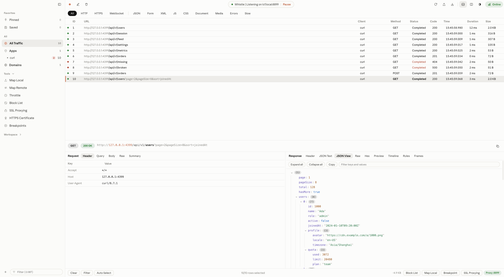

### 规则命中标识

某条请求被规则改过的话，URL 列尾部会出现一个标签，鼠标悬停能看到命中的那整行规则：

| 标签 | 对应的规则操作符 |
| --- | --- |
| Map Local | `file://` `xfile://` `tpl://` |
| Blocked | `statusCode://` |
| Throttled | `resSpeed://` `reqDelay://` 等 |
| Proxy | `proxy://` `socks://` |
| Host | `host://` |
| Modified | `replace://` `resBody://` `resHeaders://` 等 |
| Disabled | `disable://` |

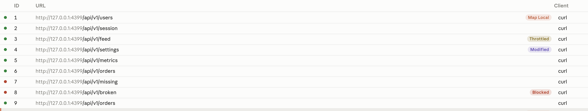

> 标识由客户端读取已启用的规则文本、在本地匹配得出，覆盖手写规则，但属于对 whistle 匹配逻辑的近似。复杂规则（多操作符组合、includes/excludes 条件）可能判得不准，以实际响应为准。

### 多条件过滤

`⌘F` 唤出过滤面板，可以叠加任意多条件，每条选字段（URL / Host / Path / Method / Status / Headers / Body / Type）和匹配方式（Contains / Not contains / Equals / Matches regex），整体按 AND 或 OR 组合。每条前面的勾选框可以临时停用而不删除，右下角 `Save` 存下这组条件，下次启动自动恢复。

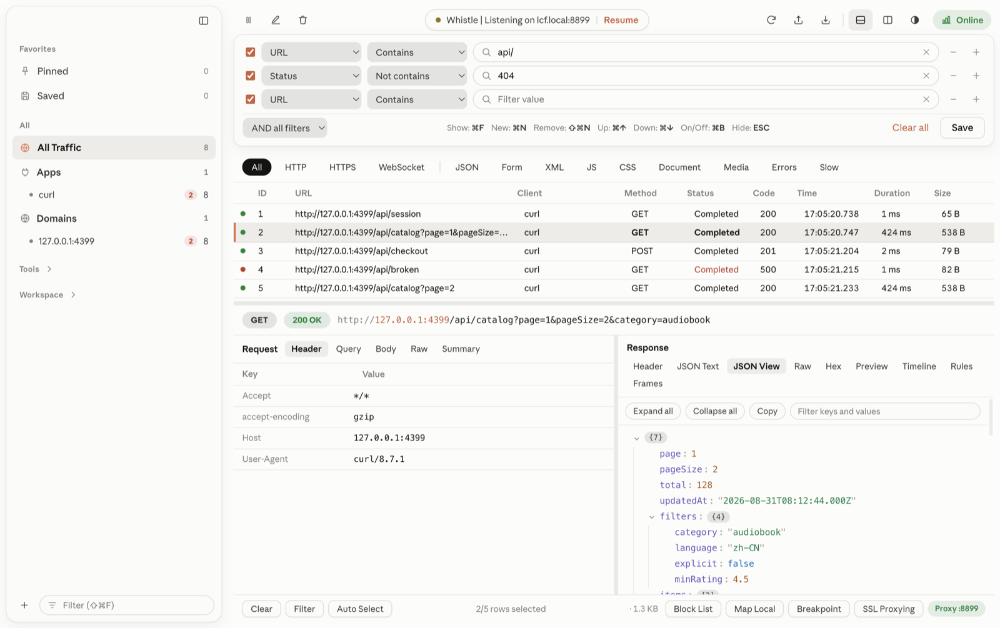

### 快捷键

快捷键作用在**你正在操作的那块区域**，而不是整个窗口。弹窗打开时它归弹窗，其余时候看你最后点的是请求列表还是 Inspector。

| 快捷键 | 在请求列表 | 在 Inspector | 弹窗打开时 |
| --- | --- | --- | --- |
| `⌘F` | 打开 URL 过滤面板 | 在当前 pane 内搜索 | 不响应 |
| `⌘A` | — | 只全选当前 pane | 只作用在弹窗内 |
| `Esc` | 关闭过滤面板 | 关闭搜索框 | 关闭弹窗 |
| `↑` `↓` | 上下切换选中的请求 | — | 不响应 |
| `⇧⌘F` | 侧边栏搜索 | 侧边栏搜索 | — |
| `⌘K` | 清空抓包列表 | | |
| `⌘R` | 开始 / 暂停抓包 | | |
| `⌘\` | 收起 / 展开侧边栏 | | |
| `⌘,` | 打开 Proxy Settings | | |

Inspector 内右键还有 Copy、Select All、Copy this pane，作用范围同样限定在当前 pane。

### 深色模式与 Inspector 停靠

右上角的按钮切换 Inspector 停在底部还是右侧，再点当前项收起；停靠位置和主题都会记住。主题跟随系统，也可以手动切换。

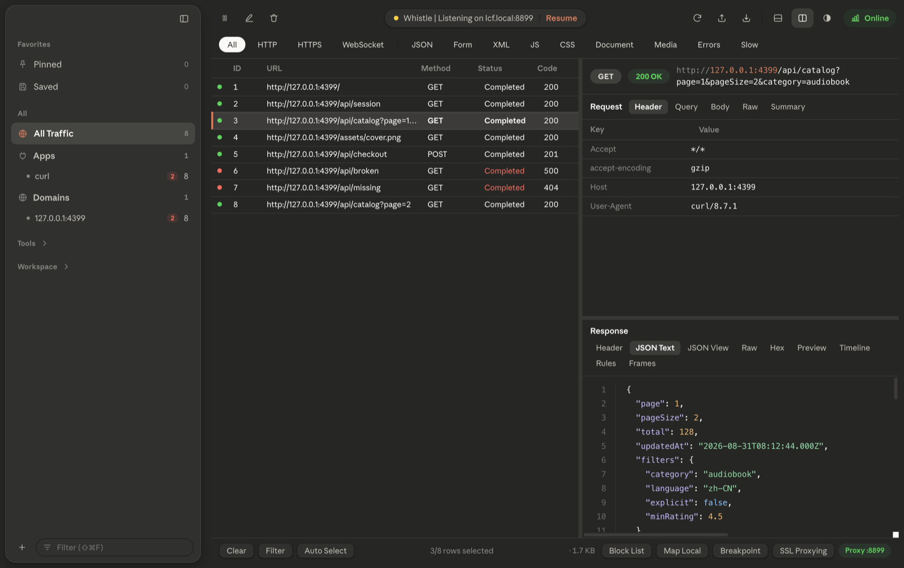

### Tools

侧边栏 `Tools` 下是几个常用的改包工具。它们生成的规则统一写进一个名为 `Modern UI Tools` 的 whistle 规则文件，每个工具占一个带标记的段落，段落之外的手写内容不受影响。

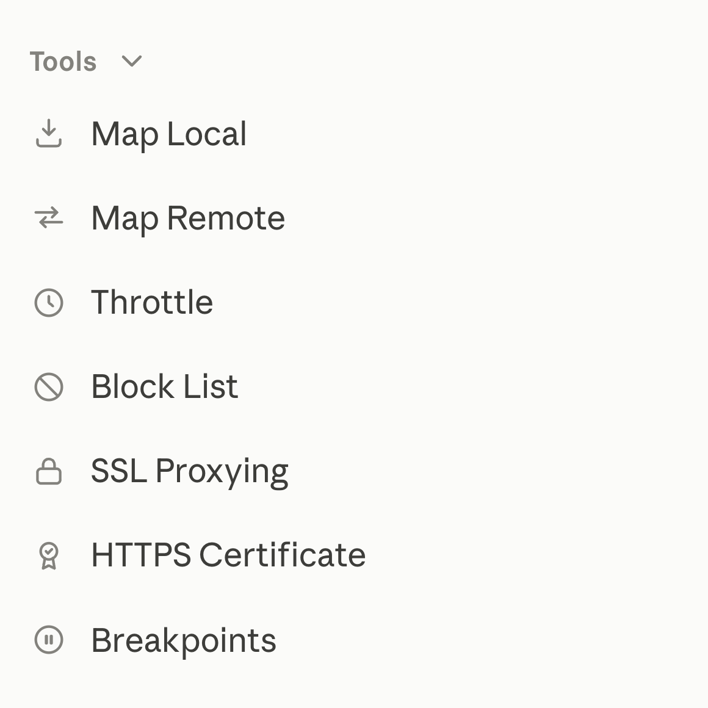

每张表的第一列都是 `On` 勾选框。取消勾选不会删掉这条规则，只是把它注释掉留在规则文件里，下次打开还在，随时勾回来。

#### Map Local

把匹配到的请求换成本地文件的内容。支持完整 URL、通配符、`/regex/`，以及 Proxyman 风格的裸正则（`.*api/v1/users.*` 会自动补成 `/.../`）。本地文件可以直接调系统文件选择器挑。

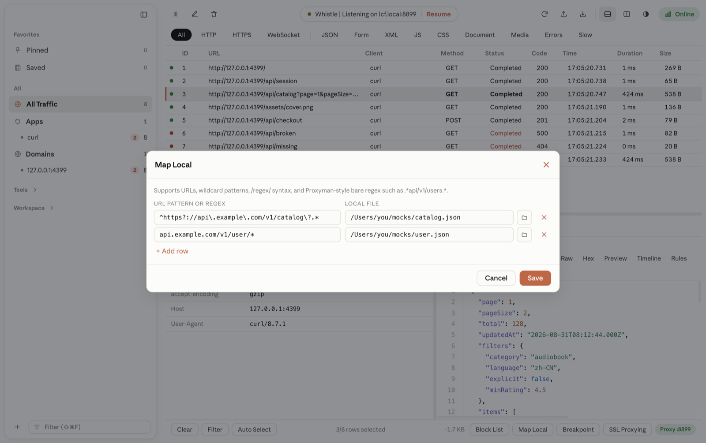

#### Map Remote

把匹配到的请求转发到另一个地址，常用于把线上域名指到本地服务。

#### Throttle

限速与延迟。预设直接照搬 Apple Network Link Conditioner 的档位（Wi-Fi / LTE / 3G / DSL / Edge / High Latency DNS / Very Bad Network / 100% Loss），选中后会把速率填进下面的表格，也可以自己改。Apple 的档位是 Kbps，whistle 用 KB/s，换算已经做好。

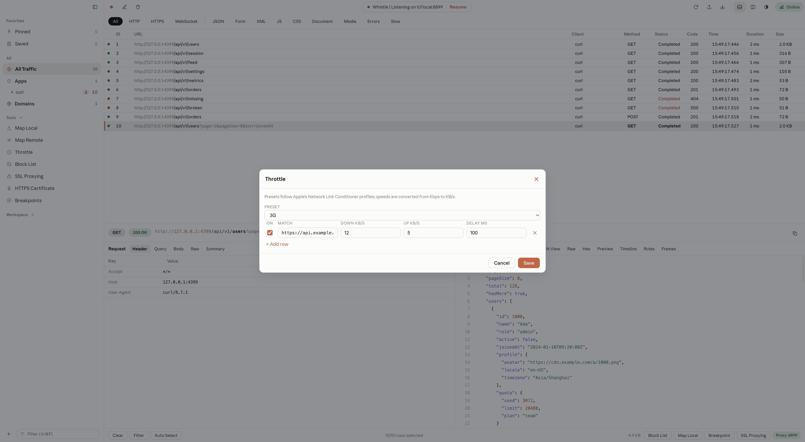

> whistle 没有丢包这个原语，所以预设里的丢包率只会以提示的形式给出，`100% Loss` 用 502 响应代替。

#### Block List

匹配到的请求直接返回指定状态码，默认 403。

#### SSL Proxying

把域名加进来就**不**解密它的 HTTPS，只留 `CONNECT` 隧道。用于绕开证书绑定（SSL Pinning）的 App，或者单纯减少噪音。

#### Breakpoints

基于 whistle 的 `reqDelay://` 把请求挂起指定毫秒数。

### 移动端抓 HTTPS

手机、平板抓 HTTPS 需要三件事：设备的代理指向本机、设备装上 whistle 的根证书并**信任**、客户端里打开 HTTPS 解密。这三步都收在一个弹窗里。

**入口**：侧边栏 `Tools → HTTPS Certificate`。右上角 `Online` 弹窗里也有一条「Set up HTTPS on another device →」。

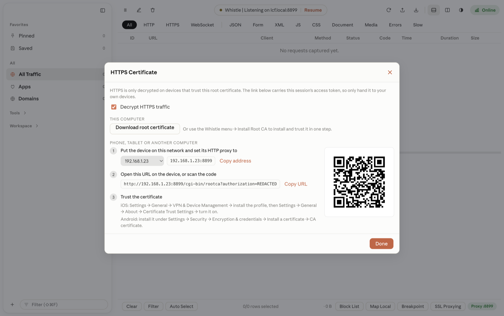

**步骤**

1. **打开 HTTPS 解密**：弹窗顶部勾上 `Decrypt HTTPS traffic`（等价于 whistle 的 `Capture HTTPS CONNECTs`）。不勾的话 HTTPS 只会以 `CONNECT` 隧道的形式出现，看不到内容。

2. **让手机和电脑在同一个 Wi-Fi 下**，然后把手机代理指向弹窗第 1 步给出的地址（形如 `192.168.1.23:8899`）。多网卡时用左边的下拉切换，选手机能访问到的那个网段。
   - iOS：`设置 → 无线局域网 → 点当前 Wi-Fi 右侧的 ⓘ → 配置代理 → 手动`，服务器和端口照抄弹窗里给的地址
   - Android：长按当前 Wi-Fi → `修改网络 → 高级选项 → 代理 → 手动`，填同样的 IP 和端口

3. **装证书**：用手机相机扫弹窗右侧的二维码，或手动打开第 2 步那条 URL。
   - iOS：Safari 会提示「已下载描述文件」，去 `设置 → 通用 → VPN与设备管理` 安装
   - Android：下载后去 `设置 → 安全 → 加密与凭据 → 安装证书 → CA 证书` 选中刚下载的文件

4. **iOS 必须再信任一次**：`设置 → 通用 → 关于本机 → 证书信任设置`，把 whistle 那一项的开关打开。只装不信任，HTTPS 依旧连不上——这一步是最常见的漏项。

5. **验证**：手机随便打开一个 https 网站，客户端列表里应该出现该域名的请求，`Code` 是 200 而不是 `CONNECT`，选中后在 Response 里能看到解密后的内容。

本机（电脑自己）的证书不用走这套：弹窗里点 `Download root certificate`，或直接用 `Whistle` 菜单 → `Install Root CA` 一键安装并信任。

> 二维码里的链接带着当前会话的访问令牌（不带的话手机会被鉴权挡住），只发给自己的设备。二维码是本地生成的，见 [`public/pm/js/qrcode.js`](./public/pm/js/qrcode.js)，没有引入第三方依赖。

**抓不到时先看这几项**

- **只看到 `CONNECT` / tunnel，没有具体请求**：`Decrypt HTTPS traffic` 没开，或者该域名被加进了 `SSL Proxying` 的排除列表
- **手机提示证书不受信任**：iOS 漏了第 4 步的「证书信任设置」；Android 9 以上，App 默认不信任用户安装的 CA，只有自家 App 配了 `networkSecurityConfig` 或用 debug 包才抓得到，系统浏览器不受影响
- **手机连不上代理**：地址别用主机名（手机通常解析不了），换成局域网 IP；确认两台设备在同一网段、电脑防火墙没拦这个端口
- **部分 App 无流量**：这类 App 多半用了证书绑定（SSL Pinning），换测试包或在 `SSL Proxying` 里放过它

### Workspace

侧边栏底部的 `Workspace` 展开后是 whistle 本身的几块，都在同一个窗口内切换：

- **Network**：抓包列表，也就是默认那一页
- **Rules**：规则文件的增删改与启停。编辑器是纯文本框，没有语法高亮，复杂规则建议切到 Classic UI 编辑
- **Values**：whistle 的 Values 存储
- **Plugins**：已安装插件的卡片列表，勾选框启停，`Open UI` 打开插件自带的界面
- **Classic UI**：把上游的经典界面内嵌在当前窗口里

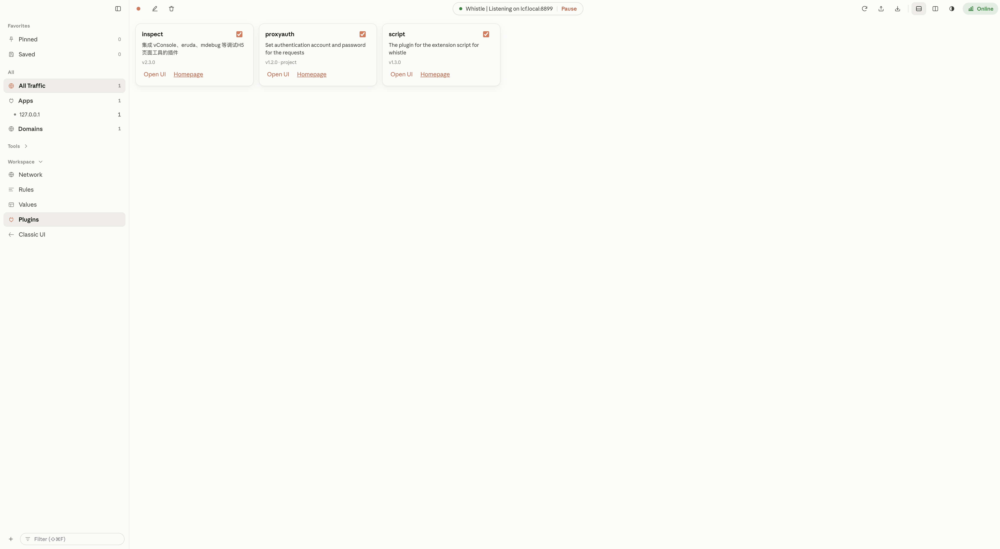

**安装插件**要在经典界面里做——现代界面的 Plugins 页只负责启停和打开插件界面，没有安装入口：

1. `Workspace → Classic UI`（或者 `Whistle` 菜单取消勾选 `Modern UI`，整窗切过去）
2. 点顶部工具栏的 `Install`
3. 弹窗里输入插件名，多个用空格分隔；右下角的 `--registry=` 下拉可以选 npm 镜像源
4. 点 `Install`

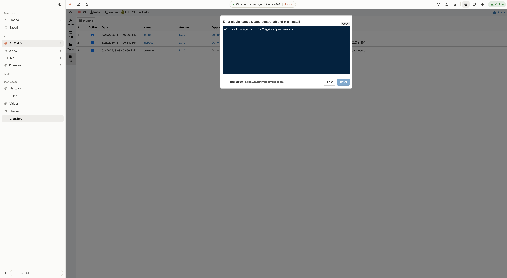

安装动作实际由客户端自己执行（`lib/plugins.js` 走 npminstall 装进客户端的插件目录），不依赖机器上有没有全局的 `w2`。

等价的命令行写法：

```txt
w2 install --registry=https://registry.npmmirror.com whistle.script whistle.inspect
```

### Proxy Settings

`Whistle` 菜单 → `Proxy Settings`，或者 `⌘,`。配置项与上游完全一致，只是换成了与主界面同一套视觉。

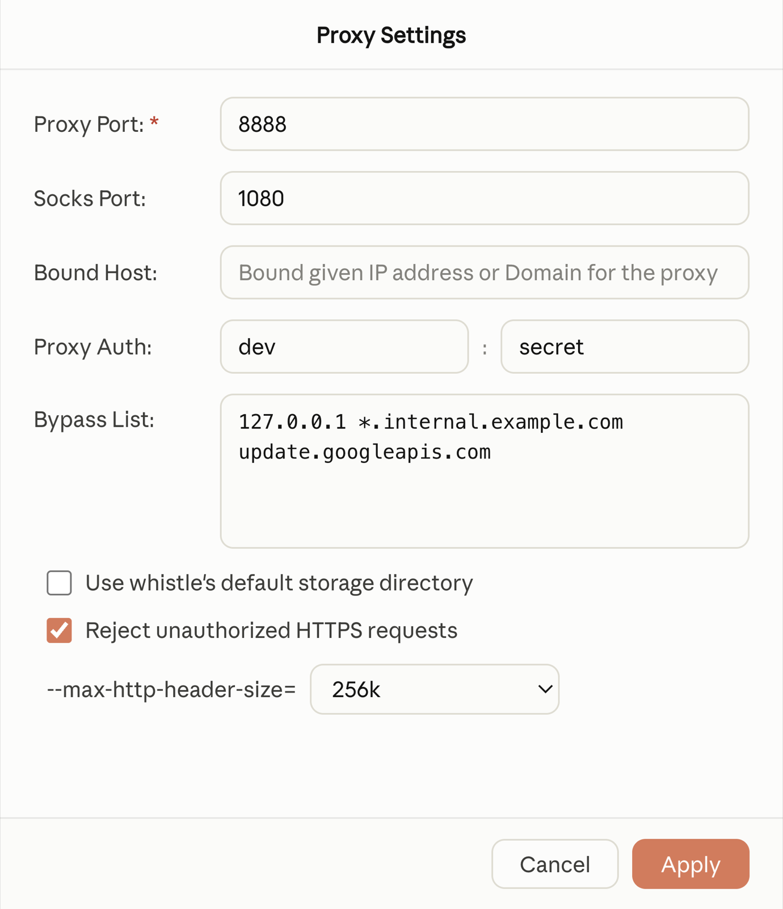

1. `Proxy Port`：必填，代理端口，默认 `8888`
2. `Socks Port`：Socks v5 代理端口
3. `Bound Host`：指定监听的网卡
4. `Proxy Auth`：给经过代理的请求加一层用户名密码鉴权
5. `Bypass List`：不走代理的白名单，支持三种写法
   - IP：`127.0.0.1`
   - 域名：`www.test.com`
   - 通配符：`*.test.com`（包含 `test.com` 的所有子域名）
6. `Use whistle's default storage directory`：存储切回命令行版本的目录，可以复用之前的配置数据。勾选后要停掉命令行版本，否则两边配置会互相覆盖

### 已知限制

- 断点（Breakpoints）是基于 `reqDelay://` 的「挂起」，不是可交互改包的真断点
- 规则编辑器是纯文本框，没有 whistle 规则语法高亮
- 插件的安装要回到经典界面
- 规则命中标识是客户端的本地近似匹配，不是 whistle 的匹配结果

> 上面除安装截图外的所有截图，请求都来自一个本地示例服务（`127.0.0.1:4399`），不含任何真实流量。

## Whistle 菜单

| 菜单项 | 作用 |
| --- | --- |
| `Proxy Settings` | 打开设置窗口（`⌘,`） |
| `Install Root CA` | 安装并信任本机根证书 |
| `Check Update` | 检查新版本 |
| `Set As System Proxy` | 把系统代理指向客户端（`⌘R`） |
| `Start At Login` | 开机自启 |
| `Modern UI` | 在现代界面和经典界面之间切换 |
| `Hide To Tray` | 关闭窗口时收进托盘而不是退出 |
| `Hide In Dock` | macOS：不在 Dock 里显示图标 |
| `Restart` / `Quit` | 重启 / 退出客户端 |

## 常见问题

**1. 设置系统代理后，部分应用（Outlook、Word 等）网络异常**

抓包界面里会出现这些域名的 `captureError` 请求。把它们加到 `Proxy Settings` 的 `Bypass List` 里即可。

**2. 如何更新客户端？**

- `Whistle` 菜单 → `Check Update`，按提示走
- 或者去 [Releases](https://github.com/cf-L/whistle-client/releases) 下载最新版，按上面的安装步骤覆盖安装

**3. 手机 / 平板怎么抓 HTTPS？**

见[移动端抓 HTTPS](#移动端抓-https)。

**4. 如何沿用命令行版本的数据？**

客户端默认使用独立的存储目录。在 `Proxy Settings` 里勾上 `Use whistle's default storage directory` 即可切回命令行版的默认目录。

> 请确保同一时间只有一个 Whistle 实例访问该目录，多实例同时运行会造成配置冲突和数据覆盖。

## 构建与发布

安装包由 GitHub Actions 在各自的原生 runner 上构建（`.github/workflows/release.yml`）：macOS 出 arm64 / x64 两个 dmg，Windows 出 x64 的 nsis 安装包，Linux 出 x64 / arm64 的 AppImage（Fedora、Ubuntu 通用）。

发布一个版本：

1. 改 `package.json` 里的 `version`，在 `CHANGELOG.md` 里补一段
2. 提交后打 tag 并推送：

   ```bash
   git tag v1.8.0 && git push origin v1.8.0
   ```

3. 工作流会把三个平台的产物传到同一个**草稿** release，正文自动取 `CHANGELOG.md` 里对应版本那一段（`scripts/release-notes.js`），检查无误后在 GitHub 上点 Publish

客户端的 `Check Update` 读取本仓库 `main` 分支的 `package.json` 版本号，点 Download 会跳到 `releases/download/v<版本>/<当前平台的安装包>`，所以 release 里的文件名必须保持 `Whistle-v<版本>-<平台>-<架构>.<后缀>` 这个格式（electron-builder 的 `artifactName` 已经按这个配好）。

本地构建（只能出当前系统的包）：

```bash
npm run build:mac
```

## License

[MIT（详见 LICENSE 文件）](./LICENSE)
